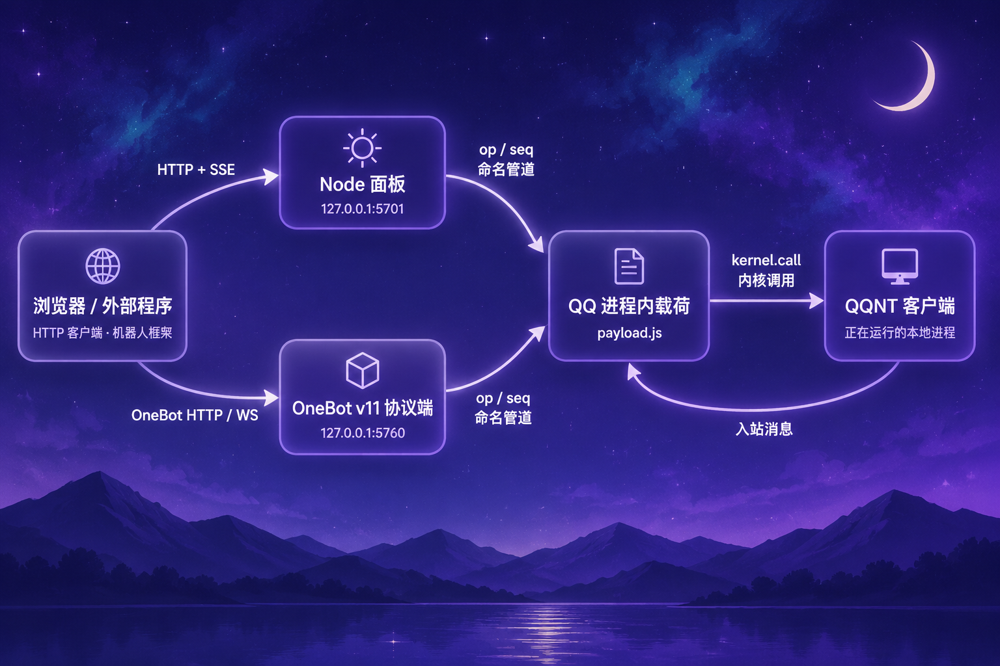

<p align="center">
  
</p>

<h1 align="center">FrishLuna</h1>

<p align="center">
  <b>把 QQNT 变成可编程的本地服务</b><br>
  旁挂注入 · 零运行时依赖 · 内置 OneBot v11 · 原生 Web 控制台
</p>

<p align="center">
  <a href="LICENSE"></a>
  <a href="https://github.com/FrishLuna/FrishLuna/releases/latest"></a>
  
  
  
  
  
  <a href="https://github.com/FrishLuna/FrishLuna/issues"></a>
</p>

---

FrishLuna 给正在运行的 QQNT 客户端做一台"旁挂式"控制台：不改安装目录、不替换客户端，
通过注入一个很小的 C 载荷拿到进程内的执行权，把消息收发、群管理、媒体上传、空间动态这些
能力整理成统一的调用接口，再由内置的 OneBot v11 协议端暴露给本机任何程序。

发一条合并转发、拉一张群相册的图、给说说点个赞、把一段文字合成语音发进群——都可以是一行 HTTP 请求。

> **使用前请务必阅读**
>
> 1. 本项目与腾讯没有任何关系，也没有获得授权或背书。「QQ」「QQNT」等名称仅用于描述兼容对象，
>    不构成商标使用许可，也不代表获得官方支持。
> 2. 要稳定请用官方方案：[QQ 机器人开放平台](https://q.qq.com/) 与
>    [官方接入文档](https://bot.qq.com/)。官方渠道经过审核，接口稳定且不影响账号；
>    本项目属于官方渠道之外对客户端行为的实验性研究，功能可能随客户端版本更新失效。
> 3. 本项目仅供个人学习与研究。使用可能导致账号被警告、限制功能、封禁或冻结，
>    也可能丢失聊天记录等本地数据，相关风险由使用者自行承担，作者不承担责任也不提供解封协助。
> 4. 严禁用于批量加好友、群发营销、自动化营销、抢红包、刷赞刷量、骚扰他人、欺诈或抓取传播数据等违法用途。
> 5. 作者保留随时停止分发、删除仓库或变更许可证的权利。

## 目录

- [能做什么](#能做什么)
- [架构](#架构)
- [快速开始](#快速开始)
- [控制台](#控制台)
- [对接外部机器人框架](#对接外部机器人框架)
- [安全设计](#安全设计)
- [配置项](#配置项)
- [实现边界](#实现边界)
- [已知限制](#已知限制)
- [常见问题](#常见问题)
- [参与贡献](#参与贡献)
- [致谢与许可](#致谢与许可)

## 能做什么

| 分类 | 能力 | 代表动作 |
|---|---|---|
| **消息** | 文本、图片、视频、语音、闪照、XML / JSON 卡片、合并转发（收发双向）、@、表情、引用回复、撤回、已读 | `send_group_msg` `send_flash_msg` `send_group_forward_msg` `get_forward_msg` `delete_msg` |
| **群管理** | 群列表与成员、禁言与解禁、踢人、设管理、改名片、改群名、公告、群荣誉、打卡、@全体剩余次数、入群申请审批 | `get_group_member_list` `set_group_add_request` `get_group_honor_info` `get_group_signed_list` |
| **媒体** | 图片 / 语音 / 文件下载，群文件上传·列表·改名，群相册上传（图 / 视频）、闪传文件集建删改查 | `get_image` `download_file` `upload_group_file` `upload_image_to_qun_album` `create_flash_task` |
| **社交** | 好友列表与申请处理、备注、删除、资料查询、点赞、戳一戳、自定义在线状态、名片赞 | `get_friend_list` `set_friend_add_request` `send_poke` `get_profile_like` `set_diy_online_status` |
| **空间** | 说说发布 / 删除 / 列表 / 详情、点赞、评论、可见范围、上传图片、空间封禁状态 | `publish_qzone_msg` `like_qzone` `comment_qzone` `get_qzone_feeds` |
| **AI 语音** | 角色列表、文字转语音、直接发进群 | `get_ai_characters` `send_group_ai_record` |
| **协议** | OneBot v11：HTTP action、正向 WS、反向 WS（手写 RFC6455 客户端）；cookie / bkn / 凭证读取 | `get_cookies` `get_csrf_tokens` `get_credentials` |

所有能力默认**只监听本机、只对持有访问令牌的操作者开放**；发送侧支持群号白名单，
收消息与发消息分开控制。

## 架构

<p align="center">
  
</p>

```
QQ 客户端    ← 本体登录，界面照常使用，安装目录不动
C 载荷       ← 旁挂注入：取 napi_env、借 V8 跑 bridge.js / ops.js，监听入站消息
Node 面板    ← 业务与展示：op → kernel.call → {cmd:'op'} → 命名管道 → payload/ops.js
外部机器人   ← 内置 OneBot v11：事件推送与 action 调用
```

- **旁挂而非替换**：不修改 `application.asar`，不动 Electron 入口，绕开完整性校验。
- **零 npm 运行时依赖**：HTTP、SSE、WebSocket（含 RFC6455 握手与帧编解码）全部手写。
- **一个出口**：面板与协议端都走 `kernel.call`，动作实现只有一份，行为不会分叉。

## 快速开始

**环境**：Windows 10 / 11（x64）、Node ≥ 22（面板用内置 `node:sqlite`，20 及以下会直接起不来）、QQNT 版 QQ（已登录）。

```text
1. 双击 app\启动 FrishLuna.vbs
   → 后台拉起面板 + 自动开浏览器 + 自动拉起 QQ 并注入
2. 首次进入：用控制台打印的初始令牌登录 → 立刻设置自己的令牌
3. 打开 http://127.0.0.1:5701 ，在「运行设置」里指定 QQ 路径
```

| 入口 | 用途 |
|---|---|
| `app\启动 FrishLuna.vbs` | 日常入口：后台启动（关窗口不停）、自动开浏览器、自动拉起并注入 QQ |
| `app\前台运行.cmd` | 前台运行，实时滚日志；首次运行用它才看得见初始令牌 |
| `app\停止面板.cmd` | 按 PID 精确停止 |

后台运行由计划任务 `FrishLuna Keepalive` 兜底：每分钟读 `app\data\panel.port`
探测真实端口（端口顺延也能识别），服务不在就静默拉起，日志在 `app\data\keepalive.log`。
也可以直接 `node tools/keepalive.mjs`；想要无控制台窗口的启动器，用
`tools/keepalive-host.c` 自行编译（仓库不提供预编译二进制）。

面板默认 `http://127.0.0.1:5701`，端口被占自动 +1。

## 控制台

| 页面 | 内容 |
|---|---|
| 登录页 | 访问令牌进入（可一键粘贴） |
| 概览 | 连接状态、QQ 进程、消息服务、最近事件 |
| 实验台 | 发消息；戳一戳、撤回、表情回应、名片赞等互动；禁言、踢人、设管理、改名片、改群名、公告等群管理；昵称签名与好友列表；群列表、群成员、最近会话、服务可用性查询 |
| 控制台 | 日志按级别与关键字过滤、暂停、导出、清空 |
| 诊断 | 运行状态与诊断信息一键复制 |
| 运行设置 | QQ 路径、自动启动、端口、禁止发送的群号 |
| 面板设置 | 主题（深 / 浅 / 跟随系统）、主色调、动效、控制台字号 |

偏好存浏览器 `localStorage`；令牌只在根目录 `.env`（盐 + 哈希）；面板仅监听 `127.0.0.1`。

## 对接外部机器人框架

| 方式 | 说明 | 配置位置 |
|---|---|---|
| HTTP API | `POST http://127.0.0.1:5760`，体 `{action, params, echo}` | 面板 → 运行设置 → 协议端令牌 |
| 正向 WS | 客户端连 `ws://127.0.0.1:5760` | 同上 |
| 反向 WS | 本端作为客户端连到框架（如 AstrBot 的 aiocqhttp 服务） | 面板 → 反向 WS 地址 |

反向 WS 是手写的 RFC6455 客户端（Node 原生 WebSocket 无法自定义请求头）。握手按 aiocqhttp
的校验要求带 `Authorization: Bearer`、`X-Self-ID`、`X-Client-Role: Universal` 三个头，
令牌也可直接写进 URL 的 `access_token=`；`get_login_info` 与 `get_status` 按规范返回。

```bash
# 发一条合并转发
curl -s -X POST http://127.0.0.1:5760/send_group_forward_msg \
  -H "Authorization: Bearer <你的协议端令牌>" \
  -H "Content-Type: application/json" \
  -d '{"group_id":1000000001,"messages":[
        {"type":"node","data":{"name":"示例","uin":1000000001,
         "content":[{"type":"text","data":{"text":"第一条"}}]}}]}'

# 拉回合并转发内容（发送回执里给了 res_id）
curl -s -X POST http://127.0.0.1:5760/get_forward_msg \
  -H "Authorization: Bearer <你的协议端令牌>" \
  -H "Content-Type: application/json" \
  -d '{"res_id":"<上一步返回的 res_id>"}'
```

`self_id` 要等本号发过一条消息，才能从消息记录里认出自己；补全前后反向 WS 会重连换请求头，
面板重启后一般半分钟内恢复。自己发出的消息拿不到回显（QQ 只推它收到的消息），
所以外部框架不会响应当前账号自己发的内容。

## 安全设计

| 面 | 做法 |
|---|---|
| 监听范围 | 面板与协议端只绑 `127.0.0.1`，非回环请求直接 403 |
| 令牌存储 | `.env` 只存 16 字节盐 + scrypt 哈希（N=16384 / r=8 / p=1，64 字节输出），无明文、无副本 |
| 令牌强度 | 8–64 位，必须同时含字母与数字；低 / 中 / 高三级，设置时前后端同规则校验 |
| 令牌回显 | 不支持回显、不支持复制；忘了只能清掉 `.env` 里的 `FL_AUTH_*` 重启重发初始令牌 |
| 传输形态 | 请求走 `x-fl-token` / `Authorization` 头，**不把令牌拼进 URL**；实时日志用 30 秒一次性票据换连接 |
| 登录态 | 仅 `sessionStorage`，关浏览器即失效，不做本机持久化 |
| 暴力尝试 | 连续 5 次失败锁 30 秒 |
| 跨站防护 | 协议端拒绝非本机 `Origin` 的请求，网页无法偷偷把本机端口当 API 用 |
| 调试通道 | 任意代码执行类接口默认关闭，需 `FL_DEV_EVAL=1` 显式开启 |
| 发送边界 | `blockedGroups` 白名单外不发；只拦发送，收消息照常 |

## 配置项

`app/data/config.json`（面板内可改）：

| 键 | 说明 |
|---|---|
| `port` / `host` | 面板监听，默认 `127.0.0.1:5701` |
| `qqExe` | QQ 可执行文件路径（设置页指定） |
| `autoInject` | 发现 QQ 在跑但未注入时自动注入 |
| `blockedGroups` | 禁止发送的群号列表，默认空（不拦截）；**用之前务必填上** |
| `obServerPort` / `obServerToken` / `obServerReverse` | 协议端端口（默认 5760）、令牌、反向 WS 列表 |

可选依赖：群相册传视频需要 `ffmpeg` 抽首帧封面。默认在 `PATH` 里找 `ffmpeg` / `ffprobe`，
装在别处用 `FL_FFMPEG`、`FL_FFPROBE` 指定完整路径；纯文本与图片链路不需要。

## 实现边界

| 层 | 实现 | 说明 |
|---|---|---|
| ① 注入进宿主 | `injector/inject.py`（OpenProcess → VirtualAllocEx → WriteProcessMemory → CreateRemoteThread/LoadLibraryW）、`launch.py` 挂起注入 | 标准 Win32 注入路径 |
| ② 进程内取执行权 | 双 detour（`napi_create_string_utf8` 一次性 + `napi_get_cb_info` 持久 trampoline），只借 V8 跑 JS | `payload/native/pkt.c` |
| ③ 消息通道 | `\\.\pipe\frishluna.<pid>.evt/.cmd`，uint32 长度 + JSON | `payload/bridge.js`、`app/server/pipe.js` |
| ④ 协议 → OneBot 11 | 编解码 `protocol/onebot11.js`，服务端 `onebot-server.js`，分发 `kernel.js` → `payload/ops.js` | — |
| ⑤ 面板与业务 | `app/server/*`、`app/web/*` | — |
| ⑥ 封送层 | `app/server/marshal.js`，运行时解析调用目标，不绑定版本 | 目前只用于只读调用 |

```text
双击 → Node 面板(127.0.0.1:5701) → REST / SSE
     → 业务 op → kernel.call → {cmd:'op',name,args,seq}
     → \\.\pipe\frishluna.<qqPid>.cmd → payload/ops.js（QQ 进程内执行）
     ← \\.\pipe\frishluna.<qqPid>.evt ← 回执 / 入站消息 / 内核事件
     ↔ 同一批事件经内置 OneBot v11 推给本机订阅方
```

几个必须踩过才知道的点：

- `getNTWrapperSession(name)` 读的是本线程注册过的缓存，不是全局工厂。按名字直接取往往只拿到
  未初始化的空壳（`getMsgService()` 底层服务为空）；必须复用宿主已有实例，不能按名字新建。
- JS 侧 `sendMsg` 参数位置很严格：`sendMsg('0', peer, msgElements, new Map())`，且 `peer.guildId`
  要填本次 `generateMsgUniqueId()` 的返回值。整包消息当第一个参数会返回 `{result:5}` 且 `errMsg` 为空。
- 主进程业务在 native 层（`isByteCodeShell: true`），`application.asar` 里没有 wrapper 调用，
  JS 层拿不到宿主正在用的 session。
- 普通启动后再注入，`engine.getDeviceInfo()` 字段为空；挂起注入能更早拿到 wrapper 对象。
- 改动 Electron 入口（`package.json` 的 `main`）会被完整性校验拦截；旁挂注入不触碰安装目录。
- 封送层只验证过只读调用。写操作即使没抛异常，也不代表可用。

## 已知限制

- 只支持 Windows + QQNT 客户端，随客户端版本更新可能失效。
- 自己发的消息没有事件回显，需要靠发送回执或历史消息自取。
- 合并转发节点内目前支持文字、@、表情；图片等富媒体会以占位文本呈现。
- 群搜索、成员搜索、商城表情面板尚未打通。
- 部分只读接口依赖 cookie，长时间运行后可能需要重登刷新。
- 协议端未设令牌时对本机全开放（有跨站拦截兜底），多用户机器请务必设置令牌。

## 常见问题

**面板打不开 / 端口不对？**
看 `app/data/panel.port` 里的真实端口（被占会顺延），或看 `app/data/keepalive.log` 的拉起记录。

**忘了访问令牌？**
删掉 `.env` 里 `FL_AUTH_*` 那几行，重启后会重新生成初始令牌并在前台控制台打印一次。
面板有意不提供回显与复制。

**QQ 更新后失效？**
客户端内部结构变化可能导致载荷调用失败，先看控制台报错；多数情况需要更新载荷里的字段与调用约定。

**会被封号吗？**
存在风险，见开头「使用前请务必阅读」。要长期稳定的机器人请走官方开放平台。

**为什么不做群发 / 自动加好友 / 抢红包这类功能？**
不属于本项目目标，也不在可接受使用范围内（见 [docs/EULA.md](docs/EULA.md)）。

## 项目结构

```
app/server/                    Node host：面板服务、鉴权、进程管理、入站消息
  kernel.js                    OneBot action → payload op 的唯一出口（seq 配对回执）
  onebot-server.js             OneBot v11：HTTP action + 手写 WS + 反向 WS
  protocol/onebot11.js         消息段 ↔ 文本 / 图片 / at 编解码
  msgid.js                     消息 ID 映射（短 id ↔ 内核 msgId）
  lab.js                       实验台操作 → action → kernel.call 的参数校验与映射
  marshal.js                   1C 封送层 host 侧驱动
app/web/                       原生 HTML / CSS / JS 控制台
payload/                       bridge.js · ops.js · inbound.js · watch.js · longmsg.js · media.js · qzone.js
payload/native/pkt.c           hook 原生模块源码（send / recv 字节直通）
injector/                      inject.py · launch.py · 权限探测
tools/                         构建、自检、离线验收（selftest / protocol-selftest）
docs/EULA.md                   可接受使用条款
```

## 参与贡献

项目刚起步，坦白讲：**坑很多，很多路径只有作者自己的机器上跑过**。QQ 客户端版本一换、
某个接口在别人的网络或账号类型下不灵，都是常事。所以任何形式的反馈都比沉默有用——
报一个 bug、补一段复现步骤、指出文档写错的地方，都算贡献。

**提 Issue**（欢迎，不用怕问题小）

- 说清三件事：你的环境（Windows 版本、QQ 版本、Node 版本）、具体现象（报错原文 / 截图）、
  复现步骤（点了什么、调了哪个 action、传了什么参数）。
- 有日志就给日志：面板「控制台」页可导出，日志里出现 `result=5`、超时、`undefined` 都很有价值。
- **贴之前先脱敏**：QQ 号、令牌、cookie、`sk-` 开头的密钥、聊天记录截图里的他人信息，一律打码。

**提 PR**（同样欢迎，小改动可以直接开）

- 修 bug、补兼容、改文案、加文档都行；想加新能力或动架构，建议先开个 Issue 聊一下，
  免得写完发现方向不对。
- 提交前请保持仓库的既有约束：**零 npm 运行时依赖**（HTTP / SSE / WebSocket 全是手写的，
  别为了省事引入框架）、只监听 `127.0.0.1`、不新增会回传明文凭据的接口。
- 一个 PR 尽量只做一件事，改动附上你怎么验证的（哪怕只是"本地跑通了这条 action"）。
- 涉及客户端的调用约定，如果和现有代码里的注释冲突，说明你实测的客户端版本——这类知识只能靠实测积累。

**不适合提的**：批量加好友、群发、抢红包、刷量这类功能与绕过风控的改法，见
[docs/EULA.md](docs/EULA.md)，不讨论也不合并。

> 维护者精力有限，Issue 不保证秒回；但每一条都会看。有用的复现步骤往往比一句"用不了"省下几小时排查。

## 致谢与许可

部分实现思路参考了 [SnowLuma](https://github.com/SnowLuma/SnowLuma/)。协议字段号、wire 布局这类
事实性内容来自对客户端行为的实测比对，代码由本项目自行编写；思路相同不等于代码相同，
仓库中不包含任何其他项目的源码副本。

源代码以 [MIT](LICENSE) 许可证开源。使用层面的免责声明与可接受使用条款见
[docs/EULA.md](docs/EULA.md)，第三方组件与运行时域名说明见 [NOTICE](NOTICE)。
仓库不包含腾讯专有源码、反编译产物、内部接口表或测试报告；实现依据的接口行为是在自有设备上
按互操作目的取得的，功能可能随 QQ 版本更新失效。

---

<p align="center">
  <sub>本项目按现状提供，不附带任何担保；与腾讯公司、QQ 及其关联方无隶属、合作、授权或背书关系。</sub><br>
  <sub>如需稳定合规的机器人能力，请使用 <a href="https://q.qq.com/">QQ 机器人开放平台</a>。</sub>
</p>
